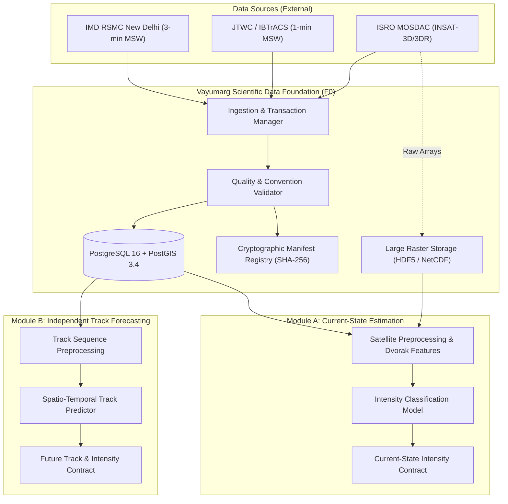
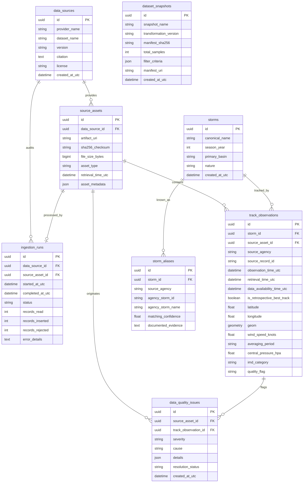

# Vayumarg System Architecture (Milestone F0)

**Project:** Vayumarg — AI/ML Decision-Support System for Tropical Cyclones  
**Problem Statement:** SIH26070 | Team VortexA  
**Status:** Approved Architecture (Milestone F0 Frozen)  

---

## 1. Architectural Philosophy

Vayumarg is built on four core architectural tenets:
1. **Decoupled Analytical Modules:** Module A (Satellite-based current-state classification and intensity estimation) and Module B (Multi-step track and future wind forecasting) are completely decoupled. **Module B does not depend on Module A predictions.**
2. **Scientific Integrity & Agency Preserving:** Meteorological conventions (specifically IMD's 3-minute sustained wind standard versus JTWC/NHC's 1-minute standard) are preserved in their native forms without ad-hoc, unvalidated conversion.
3. **Immutable Lineage & Auditability:** Every observation maps to a physical source asset with an immutable SHA-256 hash, an explicit UTC timestamp, and a data availability timestamp.
4. **Relational vs. Large Array Separation:** Relational structures (metadata, tracks, quality issues, manifests) reside in PostgreSQL/PostGIS. Dense multi-band satellite rasters (INSAT HDF5/NetCDF) remain on high-speed disk storage referenced by cryptographic manifests.

---

## 2. Decoupled Modular Architecture

---

## 3. Database Entity Relationship Diagram (ERD)

---

## 4. Software Stack Specification

| Component | Selected Technology | Version | Rationale |
| :--- | :--- | :--- | :--- |
| **Language Runtime** | Python (CPython) | 3.12.10 | Modern type system, enhanced performance, long-term support. |
| **Environment & Package Mgmt** | uv | 0.12.21 | Extremely fast virtual environment and dependency lock tool. |
| **Relational / Geospatial DB** | PostgreSQL + PostGIS | PostgreSQL 16.4 / PostGIS 3.4.3 | Canonical standard for spatial indexing, R-Tree indices, and SRID 4326 geometry operations. |
| **ORM & Database Driver** | SQLAlchemy 2 + psycopg (v3) | SQLAlchemy 2.1.6, psycopg 3.3.6 | Modern 2.0-style mapped columns, strict typing, high-performance async/sync binary driver. |
| **Schema Migrations** | Alembic | 1.20.1 | Version-controlled, reproducible schema DDL transitions. |
| **Data Contracts & Validation**| Pydantic v2 | 2.14.2 | High-throughput data parsing and strict type constraints. |
| **Geospatial & Numerics** | Shapely, NumPy, pandas | Shapely 2.2.0, NumPy 2.5.4, pandas 3.1.0 | Standard scientific computing and computational geometry stack. |
| **CLI & Interface** | Typer + Rich | Typer 0.27.3, Rich 15.0.0 | User-friendly, auditable command-line interface. |
| **Test Suite** | pytest | 9.2.0 | Automated testing with isolated unit and integration markers. |
| **Linting & Code Quality** | Ruff | 0.17.3 | Ultra-fast linter and code formatter. |

