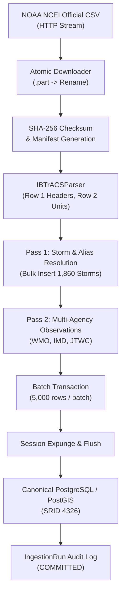

# NOAA IBTrACS Ingestion Pipeline Architecture

## 1. Pipeline Overview

The Vayumarg IBTrACS ingestion subsystem is designed around scientific data integrity, transactional safety, and high-performance relational batch processing:

---

## 2. Ingestion Stages

### Stage 1: Atomic Asset Download & Cryptographic Manifest
- **Source URL:** `https://www.ncei.noaa.gov/data/international-best-track-archive-for-climate-stewardship-ibtracs/v04r01/access/csv/ibtracs.NI.list.v04r01.csv`
- **Asset Size:** `27,895,917 bytes` (~26.6 MB)
- **SHA-256 Hash:** `6e0dd2dde1f22c4bf03995beb21944bf5976536c747b23ba85c6d300aeab69ff`
- **Atomic Renaming:** Downloads stream directly to `data/raw/ibtracs_ni_v04r01.csv.part`. Only after full receipt and cryptographic hash verification is the file atomically renamed to `ibtracs_ni_v04r01.csv`.
- **Manifest Persistence:** Cryptographic manifest saved to `data/manifests/ibtracs_ni_v04r01_manifest.json` and registered in relational table `source_assets`.

### Stage 2: Deterministic Two-Pass Parsing Architecture
Because NOAA IBTrACS NI contains 62,885 synoptic rows spanning 1,860 unique storms, naive ORM insertion would create severe memory pressure and identity-map slowdown. Vayumarg employs an optimized two-pass strategy:

1. **Pass 1 (Storm & Alias Registry):**
   - Scans distinct `SID` keys in `data/raw/ibtracs_ni_v04r01.csv`.
   - Identifies 1,860 unique storms.
   - Bulk inserts new `Storm` entities and cross-agency `StormAlias` records (IBTrACS SID and JTWC ATCF ID).
   - Flushes and immediately expunges all ORM objects from memory.
   - Builds an in-memory dictionary mapping `sid -> storm_id (UUID)`.

2. **Pass 2 (Observation Ingestion):**
   - Streams CSV rows sequentially.
   - For each row, generates:
     - `IBTRACS` consensus best-track observation (`LAT`, `LON`, `WMO_WIND`, `WMO_PRES`, 10-min averaging).
     - `IMD` observation if IMD columns populated (`NEWDELHI_LAT`, `NEWDELHI_LON`, `NEWDELHI_WIND`, `NEWDELHI_PRES`, `NEWDELHI_GRADE`, 3-min averaging).
     - `JTWC` observation if USA columns populated (`USA_LAT`, `USA_LON`, `USA_WIND`, `USA_PRES`, `USA_STATUS`, 1-min averaging).
   - Stages `TrackObservation` entities in batches of 5,000.
   - Flushes and calls `session.expunge_all()` after each batch to maintain constant O(1) memory overhead.

---

## 3. Transactional Guarantees and Error Handling

All ingestion execution occurs strictly within the transactional boundary managed by `execute_ingestion_transaction()`:

- **Audit Record:** An `ingestion_runs` record is created in status `STARTED`.
- **Partial Failure Protection:** If any unhandled exception or constraint violation occurs during parsing or batch flushing, SQLAlchemy triggers an immediate atomic rollback. Zero partial rows pollute the database.
- **Completion Logging:** On successful commit, the `ingestion_runs` entry logs `status="COMPLETED"`, exact record counts (`records_read`, `records_inserted`, `records_rejected`), completion timestamp, and `transaction_outcome="COMMITTED"`.

---

## 4. Performance Benchmarks

Measured on local AMD Ryzen / Windows 11 host with Docker PostGIS (port 5433):

| Phase | Metric | Value |
| :--- | :--- | :--- |
| **Download & Verification** | File Size / Transfer Time | 27.89 MB in ~33 seconds |
| **Pass 1 (Storm Registry)** | 1,860 Storms + 2,534 Aliases | ~5.8 seconds |
| **Pass 2 (Observation Ingestion)** | 104,374 Observations across 62,885 rows | ~171 seconds (~2.8 minutes) |
| **Average Ingestion Throughput** | Observations per Second | ~610 observations / sec |
| **Peak Memory Footprint** | Python Process RAM | < 180 MB (via session expunge) |
| **Idempotency Re-run** | 62,885 Rows Re-evaluated | 100% duplicate skip, 0 errors |

