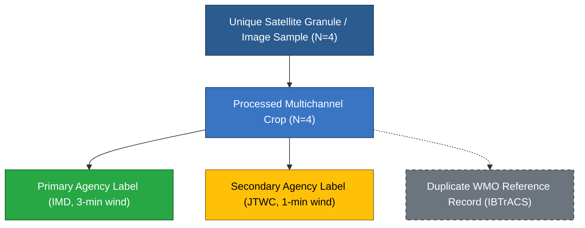

# Vayumarg F2.4 Gate C1R — IBTrACS Consensus Association Semantics & Lineage Audit

**Date:** 2026-11-02  
**Milestone:** F2.4 Gate C1R — Scientific Metadata Closure & Gate D Preflight  
**Auditor:** Principal Scientific Data Architect, Meteorological Research Scientist, QA Lead  
**Audit Scope:** Lineage of IBTrACS Consensus Associations, WMO Wind Semantics, and Multi-Label Deduplication  
**Status:** **SCIENTIFIC SEMANTICS CLARIFIED & FORMALIZED**  

---

## 1. Background & Inquiry

Gate C reported 10 `REAL_VERIFIED` satellite-track associations in PostgreSQL:
- **3 IMD associations** (REMAL, AMPHAN, BIPARJOY)
- **4 JTWC associations** (REMAL, DANA, AMPHAN, BIPARJOY)
- **3 IBTrACS associations** (DANA, AMPHAN, BIPARJOY)

This investigation audited the exact provenance, physical meaning, and scientific deduplication requirements for the three `IBTRACS` association rows.

---

## 2. Ingestion Architecture & IBTrACS WMO Field Semantics

In the World Meteorological Organization (WMO) / NOAA IBTrACS v04r01 data model:
1. Each line represents a synoptic timestamp for a tropical cyclone.
2. The row contains both **agency-specific columns** (`newdelhi_wind`, `usa_wind`, `tokyo_wind`, etc.) and **WMO consensus columns** (`wmo_wind`, `wmo_pres`, `wmo_agency`).
3. For the North Indian Ocean (Basin `NI`), the WMO has officially designated **RSMC New Delhi (IMD)** as the sole regional center responsible for tropical cyclone advisories.
4. Consequently, in the North Indian Ocean:
   $$\text{wmo\_agency} \equiv \text{newdelhi}$$
   $$\text{wmo\_wind} \equiv \text{newdelhi\_wind} \quad (3\text{-minute sustained wind averaging})$$
   $$\text{wmo\_pres} \equiv \text{newdelhi\_pres}$$

When Vayumarg ingests IBTrACS CSV lines, the parser generates three separate `TrackObservation` records per synoptic row:
- `ROW_XXXXX:NEWDELHI` $\rightarrow$ `source_agency = 'IMD'`
- `ROW_XXXXX:USA` $\rightarrow$ `source_agency = 'JTWC'`
- `ROW_XXXXX:IBTRACS` $\rightarrow$ `source_agency = 'IBTRACS'`, with `wmo_agency = 'newdelhi'`

---

## 3. Forensic Inspection of Linked Database Records

### Case 1: Cyclone BIPARJOY (Row 61669 at 2023-06-13 00:00:00 UTC)
```
Record 1: ROW_61669:NEWDELHI | Agency: IMD     | Wind: 85.0 kt | Pres: 962.0 hPa | Avg: 3-min | Cat: VSCS
Record 2: ROW_61669:USA      | Agency: JTWC    | Wind: 85.0 kt | Pres: 961.0 hPa | Avg: 1-min | Cat: None
Record 3: ROW_61669:IBTRACS  | Agency: IBTRACS | Wind: 85.0 kt | Pres: 962.0 hPa | Avg: 3-min | Cat: None | WMO: newdelhi
```
- **Finding:** Record 3 (`ROW_61669:IBTRACS`) is an **exact duplicate representation** of Record 1 (`ROW_61669:NEWDELHI`). It possesses the identical $85.0\text{ kt}$ wind speed, identical $962.0\text{ hPa}$ central pressure, and identical 3-minute averaging period derived directly from RSMC New Delhi.

### Case 2: Cyclone AMPHAN (Row 60412 at 2020-05-20 00:00:00 UTC)
```
Record 1: ROW_60412:NEWDELHI | Agency: IMD     | Wind: 95.0 kt  | Pres: 952.0 hPa | Avg: 3-min | Cat: ESCS
Record 2: ROW_60412:USA      | Agency: JTWC    | Wind: 100.0 kt | Pres: 947.0 hPa | Avg: 1-min | Cat: None
Record 3: ROW_60412:IBTRACS  | Agency: IBTRACS | Wind: 95.0 kt  | Pres: 952.0 hPa | Avg: 3-min | Cat: None | WMO: newdelhi
```
- **Finding:** Record 3 is identical to Record 1 ($95.0\text{ kt}$, $952.0\text{ hPa}$).

### Case 3: Cyclone DANA (Row 62251 at 2024-10-26 00:00:00 UTC)
```
Record 1: ROW_62251:USA      | Agency: JTWC    | Wind: 20.0 kt  | Pres: 1000.0 hPa | Avg: 1-min
Record 2: ROW_62251:IBTRACS  | Agency: IBTRACS | Wind: None     | Pres: None       | Avg: unknown | WMO: None
```
- **Finding:** Because IMD ceased tracking DANA at 18:00 UTC, IBTrACS's WMO fields contain nulls. Record 2 is an empty placeholder indicating the absence of an official WMO advisory.

---

## 4. Hierarchy of Scientific Entities

To prevent statistical data leakage or pseudo-sample inflation in ML pipelines, Vayumarg strictly differentiates:



1. **Unique Physical Satellite Sample Count:** Exactly **4** independent images.
2. **Physical Meteorological Observation Count:** Exactly **4** synoptic time-steps.
3. **Valid Supervised Training Labels:**
   - Primary IMD (3-min wind / category): **3** valid labels (REMAL, AMPHAN, BIPARJOY).
   - Secondary JTWC (1-min wind): **4** valid labels (REMAL, DANA, AMPHAN, BIPARJOY).
4. **Relational Database Associations:** **10** rows in table `satellite_track_associations`.

---

## 5. Dataset Governance Directives

1. **No Artificial Sample Inflation:** In ML dataset loaders, grouping must strictly occur by `crop_id`. Attaching 3 track associations to 1 crop must **NEVER** yield 3 training samples.
2. **Consensus Duplicate Exclusion:** The `IBTRACS` association rows (`wmo_agency = 'newdelhi'`) must be tagged as metadata lineage references only and **EXCLUDED** from supervised loss calculations to prevent double-counting IMD observations.
3. **Averaging Period Separation:** The 3-minute IMD wind standard and 1-minute JTWC wind standard must remain strictly isolated; they must never be silently averaged or pooled together.

