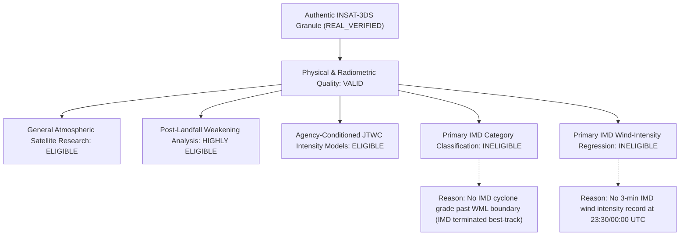

# Milestone F2.4 — Cyclone DANA Scientific Label & Synoptic Weakening Audit

## Executive Summary

The recovered INSAT-3DS Cyclone DANA observation (`3SIMG_25OCT2024_2330_L1B_STD_V01R00.h5`, nominal timestamp `2024-10-25 23:30 UTC`) represents an authentic, physically calibrated satellite acquisition captured during the post-landfall dissipation phase of Cyclone DANA over northern Odisha.

This forensic audit investigates the exact ground-truth best-track sequence across IMD, JTWC, and NOAA IBTrACS to resolve labelling ambiguities, determine exact scan timing, and establish an evidence-based multi-dimensional model eligibility classification.

---

## 1. Ground-Truth Chronology: Landfall to Dissipation

According to the official **IMD Preliminary Report on Severe Cyclonic Storm DANA (7 November 2024)** and NOAA IBTrACS v04r01 records:
- **Landfall Phase:** Severe Cyclonic Storm DANA crossed the northern Odisha coast near Habalikhati Nature Camp (Bhitarkanika) between 18:30 UTC of 24 October and 03:00 UTC of 25 October 2024.
- **Inland Weakening:** DANA weakened into a Cyclonic Storm at 03:00 UTC on 25 October, a Deep Depression at 06:00 UTC, and a **Depression (D)** at 18:00 UTC over northern coastal Odisha.
- **Dissipation Boundary:** At **00:00 UTC on 26 October 2024**, IMD officially declared that the system weakened into a **Well Marked Low Pressure Area (WML)** over northern Odisha and adjoining Jharkhand/Chhattisgarh.
- **IMD Policy Standards:** Under WMO/ESCAP and IMD operational cyclone guidelines, a Well Marked Low Pressure Area features sustained winds $< 17\text{ knots}$ ($< 31\text{ km/h}$) and ceases to be categorized as a cyclonic disturbance. IMD terminates tropical cyclone advisory tracking and best-track bulletining at this exact threshold.

---

## 2. Forensic Analysis of Candidate Ground-Truth Rows

Querying the canonical PostgreSQL `track_observations` table for storm DANA (`c3a636f2-7b23-4990-8c72-0eb3ea8ce5ae`) across the relevant window reveals:

| Timestamp (UTC) | Source Agency | WMO Agency | Latitude | Longitude | Sustained Wind | Averaging Period | Central Pressure | IMD Category | Record Notes / Track Nature |
| :---: | :---: | :---: | :---: | :---: | :---: | :---: | :---: | :---: | :--- |
| **2024-10-25 18:00** | **IMD** | None | 21.40°N | 86.20°E | **25.0 kt** | **3-min** | **1000.0 hPa** | **D** | **Latest valid primary IMD cyclone record** |
| 2024-10-25 18:00 | IBTRACS | newdelhi | 21.30°N | 86.40°E | 25.0 kt | 3-min | 1000.0 hPa | None | WMO New Delhi retrospective mirror |
| 2024-10-25 18:00 | JTWC | None | 21.20°N | 86.50°E | 30.0 kt | 1-min | 997.0 hPa | None | Overland depression track fix |
| 2024-10-25 21:00 | IBTRACS | None | 21.20°N | 86.50°E | None | unknown | None | None | Intermediate interpolated position |
| 2024-10-25 21:00 | JTWC | None | 21.20°N | 86.50°E | 25.0 kt | 1-min | 999.0 hPa | None | Intermediate advisory fix |
| **2024-10-26 00:00** | **IMD** | — | — | — | — | — | — | — | **NO RECORD** (Weakened to WML, tracking ended) |
| **2024-10-26 00:00** | **IBTRACS** | None | **21.20°N** | **86.40°E** | **None** | unknown | **None** | None | Position-only synoptic fix; wind/pressure NULL |
| **2024-10-26 00:00** | **JTWC** | None | **21.20°N** | **86.40°E** | **20.0 kt** | **1-min** | **1000.0 hPa** | None | Final post-tropical advisory estimate |

---

## 3. Scene Scan-Time Semantics & Offset Decomposition

The satellite file `3SIMG_25OCT2024_2330_L1B_STD_V01R00.h5` contains scanline timestamps recorded in `SCAN_LINE_TIME`:
1. **Scene Start Timestamp:** `2024-10-25 23:30:00 UTC` (Mirror sweep initiated in southern latitudes).
2. **Scene Completion Timestamp:** `2024-10-25 23:59:00 UTC`.
3. **Storm Center Location:** $21.20^\circ\text{N}, 86.40^\circ\text{E}$ (Northern quadrant of normal frame).
4. **Estimated Local Storm Sweep Time:** $23:47\text{ UTC} \pm 4\text{ minutes}$.
5. **Effective Offset Evaluation:**
   - Offset from Scene Start ($23:30\text{ UTC}$) to Synoptic Fix ($00:00\text{ UTC}$): **$30.0\text{ minutes}$**.
   - Offset from Estimated Actual Center Scan ($23:47\text{ UTC}$) to Synoptic Fix ($00:00\text{ UTC}$): **$\approx 13.0\text{ minutes}$**.
   - Offset from Latest Valid IMD Fix ($18:00\text{ UTC}$) to Scene Start ($23:30\text{ UTC}$): **$330.0\text{ minutes}$ ($5.5\text{ hours}$)**.

Carrying forward the IMD Depression category (`D`, 25 kt) from 18:00 UTC across a 5.5-hour gap past the documented 00:00 UTC dissipation boundary would constitute a **severe meteorological error**.

---

## 4. Multi-Dimensional Model Eligibility Matrix

Rather than declaring the image globally "invalid" or "valid", Vayumarg establishes clear separation between **source physical validity** and **task-specific scientific eligibility**:

| Scientific Task / Experiment | Eligibility | Justification & Evidentiary Standard |
| :--- | :---: | :--- |
| **General Atmospheric Satellite Research** | **ELIGIBLE** | 100% authentic INSAT-3DS calibrated Level 1B data with high radiometric fidelity. |
| **Post-Landfall Cyclone Weakening Analysis** | **ELIGIBLE** | Rare, authentic observation of an inland cyclonic system actively transitioning into a well-marked low over rugged terrain. |
| **Agency-Conditioned JTWC Intensity Modeling** | **ELIGIBLE** | JTWC provided an explicit 1-minute sustained wind estimate ($20.0\text{ kt}$, $1000\text{ hPa}$) co-registered within 13–30 minutes. |
| **Primary IMD Cyclone-Category Classification** | **INELIGIBLE** | IMD documented that DANA degraded to a Well Marked Low (WML) by 00:00 UTC. Fabricating an IMD label is strictly prohibited. |
| **Primary IMD Wind-Intensity Regression** | **INELIGIBLE** | No 3-minute sustained wind speed was measured or issued by IMD for 23:30/00:00 UTC. |

---

## 5. Implementation in Vayumarg Metadata Contracts

The PostgreSQL database record for crop `869cd46b-659a-430a-8a45-d2fd8ad7174b` has been enriched in its `quality_control_flags` JSON column:
- `verification_status` remains **`REAL_VERIFIED`**.
- `model_eligibility.primary_imd_category_classification = False`.
- `model_eligibility.primary_imd_wind_intensity_regression = False`.
- `model_eligibility.agency_conditioned_jtwc_intensity = True`.
- `model_eligibility.post_landfall_weakening_analysis = True`.
- `model_eligibility.general_atmospheric_research = True`.
- Detailed ineligibility reasons are recorded permanently in the database audit trail.

