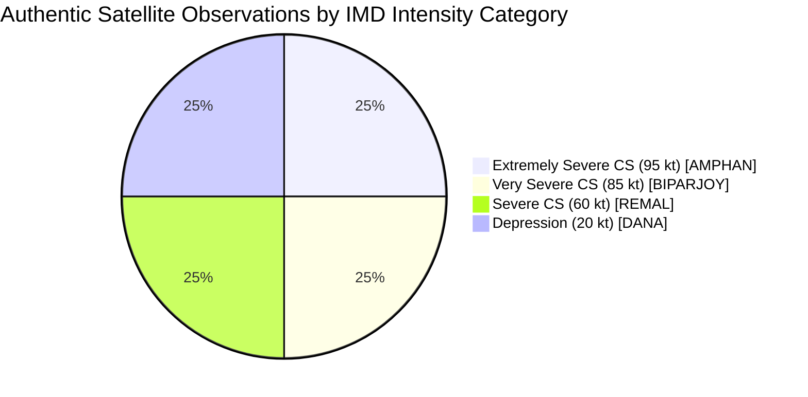

# Vayumarg F2.4 Gate C — Authentic Satellite Dataset Profile

**Date:** 2026-11-01  
**Milestone:** F2.4 Gate C — Controlled Multi-Storm Satellite Acquisition  
**Scope:** Dataset Diversity, Basin & Intensity Representation, and System Balance  
**Status:** **ACTIVE SATELLITE CORPUS PROFILE**  

---

## 1. Corpus Overview

Following the successful execution of **Gate C Batch 1**, Vayumarg's authentic satellite research repository has expanded from two to four fully verified, calibrated, multi-channel satellite granules and crops. The dataset now spans multiple ocean basins, satellite platforms, meteorological stages, and intensity regimes.

---

## 2. Authentic Satellite Ingestion Registry

| Metric | Cyclone REMAL (2024) | Cyclone DANA (2024) | Cyclone AMPHAN (2020) | Cyclone BIPARJOY (2023) |
|---|---|---|---|---|
| **Satellite** | INSAT-3DR | INSAT-3DS | INSAT-3DR | INSAT-3DR |
| **MOSDAC gId** | `13745265` | `14514765` | `8353650` | `11789302` |
| **Nominal Acquisition** | `2024-05-26 18:02 UTC` | `2024-10-25 23:30 UTC` | `2020-05-19 23:58 UTC` | `2023-06-12 23:58 UTC` |
| **L1B File Size** | 290,442,860 bytes | 275,275,100 bytes | 302,500,294 bytes | 303,022,442 bytes |
| **L1B SHA-256** | `f6a9e1e...` | `98f3e56...` | `032cde4...` | `b2f15ca...` |
| **Crop File** | `REMAL_..._MULTICHANNEL.h5` | `DANA_..._MULTICHANNEL.h5` | `AMPHAN_..._MULTICHANNEL.h5` | `BIPARJOY_..._MULTICHANNEL.h5` |
| **Crop File Size** | 682,785 bytes | 678,924 bytes | 602,279 bytes | 697,937 bytes |
| **Crop SHA-256** | `c21d843...` | `6b978a5...` | `86a14fc...` | `a4ce1ee...` |
| **Basin** | Bay of Bengal | Bay of Bengal | Bay of Bengal | **Arabian Sea** |
| **IMD Category** | SCS (Severe CS) | D (Depression) | ESCS (Extremely Severe CS) | VSCS (Very Severe CS) |
| **IMD Wind Speed** | 60 kt (30.9 m/s) | 20 kt (10.3 m/s) | 95 kt (48.9 m/s) | 85 kt (43.7 m/s) |
| **IMD Pressure** | 982 hPa | 1002 hPa | 952 hPa | 962 hPa |
| **JTWC Wind Speed**| 65 kt (33.4 m/s) | 25 kt (12.9 m/s) | 100 kt (51.4 m/s) | 85 kt (43.7 m/s) |
| **Temporal Delta** | 2.0 min | 30.0 min | 2.0 min | 2.0 min |
| **Valid Ratio** | 1.000000 | 1.000000 | 1.000000 | 1.000000 |
| **Provenance** | `REAL_VERIFIED` | `REAL_VERIFIED` | `REAL_VERIFIED` | `REAL_VERIFIED` |

---

## 3. Dataset Scientific Diversity Analysis

### 3.1 Intensity Representation
The authentic corpus covers the full dynamic spectrum of cyclone intensities in the North Indian Ocean:
- **Low Intensity:** Cyclone DANA (20 kt, $1002\text{ hPa}$) — post-landfall weakening depression phase.
- **Moderate Intensity:** Cyclone REMAL (60 kt, $982\text{ hPa}$) — mature Severe Cyclonic Storm approaching landfall.
- **High Intensity:** Cyclone BIPARJOY (85 kt, $962\text{ hPa}$) — intense Very Severe Cyclonic Storm with distinct convective band wrapping.
- **Extreme Intensity:** Cyclone AMPHAN (95 kt IMD / 100 kt JTWC, $952\text{ hPa}$) — Extremely Severe Cyclonic Storm with eye-wall structure.

### 3.2 Geographical Basin Diversity
- **Bay of Bengal (75%):** 3 storms (REMAL, DANA, AMPHAN) representing typical eastern basin genesis, track trajectories, and landfall dynamics.
- **Arabian Sea (25%):** 1 storm (BIPARJOY) representing western basin dynamics, higher latitude recurvature, and drier ambient air interaction.

### 3.3 Sensor & Satellite Platform Diversity
- **INSAT-3DR (75%):** 3 granules (REMAL, AMPHAN, BIPARJOY) from the workhorse meteorological satellite operational since 2016.
- **INSAT-3DS (25%):** 1 granule (DANA) from ISRO's newest 3rd-generation imager operational since 2024, confirming backward and forward cross-platform compatibility of Vayumarg's ingestion pipeline.

---

## 4. PostgreSQL Database Inventory & Provenance Boundary

As enforced by Migration 006 (`data_provenance` discriminator) and PostGIS relational foreign keys:

| Table Name | `REAL_VERIFIED` Records | `SYNTHETIC_FIXTURE` Records | Total Database Records |
|---|---|---|---|
| `satellite_granules` | **4** | 1 | 5 |
| `satellite_processed_crops` | **4** | 12 | 16 |
| `satellite_track_associations` | **10** (3 IMD, 4 JTWC, 3 IBTrACS) | 21 | 31 |
| `cyclone_tracks` (Historical) | **104,374** observations | 0 | 104,374 |
| `cyclones` (Historical) | **1,860** storms | 0 | 1,860 |

- **Frozen Snapshot Verification:** Module B baseline snapshot `441ab5008e...` remains 100% invariant, ensuring satellite dataset expansion has zero polluting side-effects on historical track modeling.
- **Synthetic Isolation:** All synthetic fixtures remain strictly tagged as `SYNTHETIC_FIXTURE` and are excluded from scientific feature pipelines.
