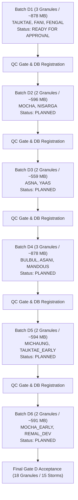

# Vayumarg F2.4 Gate D1 — Phased Acquisition Schedule (Batches D1–D6)

**Date:** 2026-11-02  
**Milestone:** F2.4 Gate D1 — Balanced Acquisition Selection & First-Batch Preflight  
**Architect:** Principal Scientific Data Architect, Acquisition Systems Engineer  
**Scope:** Six-Batch Implementation Schedule for the 14 Planned Candidate Granules  
**Planning Status:** **GATE D1 READY FOR APPROVAL; BATCHES D2–D6 PLANNED & PENDING**  

---

## 1. Phased Rollout Architecture

To guarantee strict network budget enforcement, prevent denial-of-service flags on SAC MOSDAC servers, and allow rigorous quality-control gates after every download, the remaining 14 granules of the 18-granule cohort are divided into six sequential, bounded batches.

---

## 2. Detailed Batch Specifications

| Batch ID | Granules | Cyclone Storms & SIDs | Scientific Objectives | Platform(s) | Est. Payload | New Eligible Samples | Status |
|---|---|---|---|---|---|---|---|
| **GATE_D1** | **3** | **TAUKTAE** (`2021133N10071`) **FANI** (`2019116N02090`) **FENGAL** (`2024329N04089`) | Arabian Sea peak ESCS, BoB super cyclone pre-landfall, and modern INSAT-3DS active CS ($45\text{ kt}$). | 2 $\times$ INSAT-3DR 1 $\times$ INSAT-3DS | **$878\text{ MB}$** | **3** (IMD & JTWC) | **READY FOR OWNER APPROVAL** |
| **GATE_D2** | **2** | **MOCHA** (`2023129N08091`) **NISARGA** (`2020153N13072`) | Category 5 equivalent central BoB anchor ($115\text{ kt}$) paired with eastern Arabian Sea coastal cyclone ($60\text{ kt}$). | 2 $\times$ INSAT-3DR | **$596\text{ MB}$** | **2** (IMD & JTWC) | Planned (Pending D1 completion) |
| **GATE_D3** | **2** | **ASNA** (`2024238N25077`) **YAAS** (`2021143N15090`) | Rare land-to-sea Arabian Sea storm on INSAT-3DS paired with North BoB pre-landfall VSCS ($75\text{ kt}$). | 1 $\times$ INSAT-3DS 1 $\times$ INSAT-3DR | **$576\text{ MB}$** | **2** (IMD & JTWC) | Planned (Pending D2 completion) |
| **GATE_D4** | **3** | **BULBUL** (`2019302N11118`) **ASANI** (`2022126N07095`) **MANDOUS** (`2022338N05100`) | Recurving BoB VSCS ($75\text{ kt}$), central BoB SCS ($55\text{ kt}$), and southwest BoB winter storm ($50\text{ kt}$). | 3 $\times$ INSAT-3DR | **$878\text{ MB}$** | **3** (IMD & JTWC) | Planned (Pending D3 completion) |
| **GATE_D5** | **2** | **MICHAUNG** (`2023334N08088`) **TAUKTAE_EARLY** (`2021133N10071`) | Heavy-rain slow-moving coastal SCS paired with longitudinal rapid intensification frame of TAUKTAE ($65\text{ kt}$). | 2 $\times$ INSAT-3DR | **$594\text{ MB}$** | **2** (IMD & JTWC) | Planned (Pending D4 completion) |
| **GATE_D6** | **2** | **MOCHA_EARLY** (`2023129N08091`) **REMAL_DEV** (`2024145N14087`) | Longitudinal intensification frame of MOCHA ($65\text{ kt}$) paired with early cyclogenesis / depression frame of REMAL ($30\text{ kt}$). | 2 $\times$ INSAT-3DR | **$591\text{ MB}$** | **2** (IMD & JTWC) | Planned (Pending D5 completion) |

---

## 3. Cumulative Resource Accounting Across All Six Batches

- **Existing Acquired Granules ($N=4$):** ~1.17 GB
- **Proposed Batches D1–D6 ($N=14$):** ~4.11 GB
- **Total 18-Granule Cohort Storage:** ~5.28 GB
- **Target Drive C: Headroom:** ~49.13 GB free (Safety Margin: $> 9.3\times$).
- **Overall Unique Cyclone Events:** Exactly **15 unique storm SIDs**.

---

## 4. Operational Governance Directive

Every batch transition requires:
1. Complete download and checksum verification of all batch files.
2. Multichannel crop extraction and LUT radiometric calibration.
3. PostgreSQL registration in `satellite_granules`, `satellite_processed_crops`, and `satellite_track_associations`.
4. Automated test regression verification (pytest passing 100%).
5. Explicit owner authorization prior to advancing to the next batch.

