# Vayumarg F2.4 Gate D1 — Model Eligibility Preflight & Ingestion Governance

**Date:** 2026-11-02  
**Milestone:** F2.4 Gate D1 — Balanced Acquisition Selection & First-Batch Preflight  
**Auditor:** Meteorological Data Scientist, ML Dataset Architect, Independent QA Auditor  
**Scope:** Acceptance Gates, Label Conditioning Rules, and Downstream Model Ingestion Safeguards  
**Status:** **ELIGIBILITY FRAMEWORK FORMALIZED FOR GATE D1**  

---

## 1. Governance Principles & Ingestion Gates

Under Vayumarg scientific protocols, downloading an authentic satellite granule does not automatically qualify it as an active supervised training example. Every acquired granule must pass nine independent sequential gates before inclusion in ML feature stores:

```mermaid
flowchart LR
    G1["Gate 1: Provenance<br>(SAC/ISRO L1B)"] --> G2["Gate 2: HDF5 Structure<br>(Group/Dataset Integrity)"]
    G2 --> G3["Gate 3: Radiometric QC<br>(LUT Calibration & Clamping)"]
    G3 --> G4["Gate 4: Geolocation<br>(Valid Pixel Ratio >= 0.90)"]
    G4 --> G5["Gate 5: Temporal Offset<br>(|Delta t| <= 60 min)"]
    G5 --> G6["Gate 6: Agency Separation<br>(IMD 3-min vs JTWC 1-min)"]
    G6 --> G7["Gate 7: WMO Deduplication<br>(Exclude Duplicate References)"]
    G7 --> G8["Gate 8: Dissipation Boundary<br>(No Extrapolation Past WML)"]
    G8 --> G9["Gate 9: Sample Grouping<br>(1 Image = 1 Sample)"]
```

---

## 2. Gate D1 Preflight Eligibility Audit ($N=3$)

### Granule 1: Cyclone TAUKTAE (2021) — `3RIMG_16MAY2021_2358_L1B_STD_V01R00.h5`
- **Acquisition Timestamp:** `2021-05-16 23:58:00 UTC`
- **Estimated Local Scan Time:** `2021-05-17 00:00:15 UTC` ($\Delta t = +2.0\text{ min}$)
- **Primary IMD Ground Truth:** Continuous Wind: **$100.0\text{ kt}$** ($51.4\text{ m/s}$), Category: **`ESCS`**, Central Pressure: **$950\text{ hPa}$**.
- **Secondary JTWC Ground Truth:** Continuous Wind: **$120.0\text{ kt}$** ($61.7\text{ m/s}$), Central Pressure: **$934\text{ hPa}$**.
- **Preflight Model Eligibility:**
  - Task A1 (Primary IMD Wind Regression): **ELIGIBLE**
  - Task A2 (Primary IMD Category Classification): **ELIGIBLE** (`ESCS`)
  - Task A3 (Agency-Conditioned JTWC Regression): **ELIGIBLE**
  - Task A4 (Post-Landfall Weakening): **INELIGIBLE** (Open ocean phase)
  - Task A5 (Self-Supervised Atmospheric Feature Learning): **ELIGIBLE**

### Granule 2: Cyclone FANI (2019) — `3RIMG_02MAY2019_2358_L1B_STD_V01R00.h5`
- **Acquisition Timestamp:** `2019-05-02 23:58:00 UTC`
- **Estimated Local Scan Time:** `2019-05-03 00:00:20 UTC` ($\Delta t = +2.0\text{ min}$)
- **Primary IMD Ground Truth:** Continuous Wind: **$105.0\text{ kt}$** ($54.0\text{ m/s}$), Category: **`ESCS`**, Central Pressure: **$940\text{ hPa}$**.
- **Secondary JTWC Ground Truth:** Continuous Wind: **$135.0\text{ kt}$** ($69.4\text{ m/s}$), Central Pressure: **$922\text{ hPa}$**.
- **Preflight Model Eligibility:**
  - Task A1 (Primary IMD Wind Regression): **ELIGIBLE**
  - Task A2 (Primary IMD Category Classification): **ELIGIBLE** (`ESCS`)
  - Task A3 (Agency-Conditioned JTWC Regression): **ELIGIBLE**
  - Task A4 (Post-Landfall Weakening): **INELIGIBLE** (Pre-landfall ocean phase)
  - Task A5 (Self-Supervised Atmospheric Feature Learning): **ELIGIBLE**

### Granule 3: Cyclone FENGAL (2024) — `3SIMG_29NOV2024_2330_L1B_STD_V01R00.h5`
- **Acquisition Timestamp:** `2024-11-29 23:30:00 UTC`
- **Estimated Local Scan Time:** `2024-11-29 23:32:15 UTC` ($\Delta t = 28.0\text{ min}$)
- **Primary IMD Ground Truth:** Continuous Wind: **$45.0\text{ kt}$** ($23.1\text{ m/s}$), Category: **`CS`**, Central Pressure: **$994\text{ hPa}$**.
- **Secondary JTWC Ground Truth:** Continuous Wind: **$45.0\text{ kt}$** ($23.1\text{ m/s}$), Central Pressure: **$994\text{ hPa}$**.
- **Preflight Model Eligibility:**
  - Task A1 (Primary IMD Wind Regression): **ELIGIBLE**
  - Task A2 (Primary IMD Category Classification): **ELIGIBLE** (`CS`)
  - Task A3 (Agency-Conditioned JTWC Regression): **ELIGIBLE**
  - Task A4 (Post-Landfall Weakening): **INELIGIBLE** (Active maritime cyclonic storm)
  - Task A5 (Self-Supervised Atmospheric Feature Learning): **ELIGIBLE**

---

## 3. Training Set Evolution Summary

Assuming successful execution and verification of Batch D1:

| Metric | Current Verified Baseline | Post-Gate D1 Expected Corpus | Net Scientific Gain |
|---|---|---|---|
| **Total Authentic Granules** | 4 | **7** | +3 authentic L1B standard files |
| **Unique Cyclone Events (SIDs)** | 4 | **7** | +3 distinct storm systems |
| **Primary IMD Category Eligible**| 3 (REMAL, AMPHAN, BIPARJOY)| **6** (+TAUKTAE, +FANI, +FENGAL) | **+100% expansion in primary training targets** |
| **Primary IMD Wind Eligible** | 3 | **6** | +3 continuous wind targets |
| **Secondary JTWC Eligible** | 4 | **7** | +3 agency-conditioned targets |
| **Arabian Sea Representation** | 1 (25.0%) | **2 (28.6%)** | Added 100 kt Arabian Sea ESCS anchor |
| **INSAT-3DS Platform Samples** | 1 (DANA - Ineligible IMD) | **2** (Includes 1st valid 3DS IMD target)| Added operational 3DS CS training sample |
| **Intensity Range Coverage** | 20, 60, 85, 95 kt | **20, 45, 60, 85, 95, 100, 105 kt** | Spans CS, SCS, VSCS, and ESCS |

---

## 4. Downstream Safeguards

1. **Strict 1 Image = 1 Sample:** Each crop retains a unique UUID. Grouping by `crop_id` is mandatory in PyTorch / TensorFlow dataset loaders.
2. **Duplicate Reference Suppression:** Track associations with `wmo_agency = 'newdelhi'` must be flagged as metadata references only and excluded from loss computation to avoid duplicating IMD targets.
3. **Averaging Period Separation:** 3-minute IMD targets and 1-minute JTWC targets must remain strictly partitioned.

