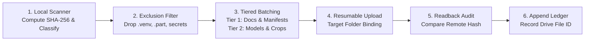

# VAYUMARG 3.0 — P1 CLOUD BACKUP ARCHITECTURE & TRANSFER DESIGN

**Document Version:** 1.0.0  
**Date:** 7 November 2026  
**Auditor:** Scientific Data Infrastructure Architect & Python Automation Engineer  
**Direction:** Unidirectional (`LOCAL_WORKSPACE -> GOOGLE_DRIVE_ROOT`)  
**Designated Root ID:** `18Yvd7LFeNSKWA3ieGpLNk8-lzMf62tth`  

---

## 1. Core Architecture & Transfer Philosophy

The Vayumarg scientific backup pipeline adheres to five non-negotiable data-protection principles:
1. **Unidirectional Push:** Data flows strictly from the local workspace to Google Drive. Bi-directional file synchronization is explicitly prohibited to prevent remote ghost deletions or accidental local file overwriting.
2. **Readback & Cryptographic Verification:** An upload is never marked successful merely because the API returned HTTP 200. Every uploaded file must undergo a readback verification where the remote file's MD5/SHA-256 or byte stream is checked against the local pre-computed hash.
3. **No Overwrite Policy:** Existing files in Google Drive are immutable. New versions receive timestamped snapshot suffixes (e.g., `satellite_cnn_best_20261107.pt`), preserving a historical audit trail.
4. **Resumable Multi-Part Streaming:** Large binary assets (checkpoints $>50\text{ MB}$, database dumps) utilize Google Drive's chunked resumable upload protocol with exponential backoff retry.
5. **Machine-Readable Ledger:** Every transfer operation writes an immutable JSON receipt to `reports/v3/transfer_ledger.json` recording local path, Drive file ID, bytes transferred, transfer duration, and verified hash.

---

## 2. Pipeline Execution Stages

### Stage 1: Pre-Flight Classification & Hashing
The local backup engine iterates over eligible project paths, computing SHA-256 digests and file metadata. It consults the asset inventory to verify that the file is not listed under `TEMPORARY` or `SECRET_OR_PRIVATE`.

### Stage 2: Manifest Generation & Dry-Run Evaluation
Before initiating any network transfer, the engine generates a dry-run transfer manifest:
- Source path, size, and hash.
- Target Drive parent folder ID.
- Expected upload size in bytes.
- Licensing and approval flags.

### Stage 3: Authenticated Upload via Official Drive API / MCP
- Chunked uploads (5 MB chunks) for files $> 5\text{ MB}$.
- Exponential backoff retry on HTTP 429 (Rate Limit) or 5xx server errors ($1\text{ s}, 2\text{ s}, 4\text{ s}, 8\text{ s}$, max 5 attempts).
- Concurrency bounded to a maximum of 2 parallel streams to prevent client network throttling.

### Stage 4: Readback & Remote Verification
- Query file metadata via `files.get(fileId, fields='id, name, size, md5Checksum, parents')`.
- Verify file size matches local byte length.
- If text/json, read back content and verify bitwise string equality.
- If binary, verify MD5/checksum or read back header/footer bytes.

### Stage 5: Recovery Manifest Production
Emit `reports/v3/recovery_manifest.json` mapping every remote asset to its intended local restoration path.

---

## 3. Tiered Transfer Plan

| Tier | Description | Target Drive Folder | File Count | Total Size | Approval Gate |
| :--- | :--- | :--- | :--- | :--- | :--- |
| **Tier 1 (Foundation)** | Research Reports, Public Docs, Dataset Manifests, Checksum Ledgers | `01_Project_Management`, `04_Research_Experiments`, `05_Project_Documentation` | 183 files | **~12.5 MB** | **APPROVED** (Eligible immediately upon OAuth) |
| **Tier 2 (Checkpoints & Crops)** | 4 PyTorch `.pt` Checkpoints + 5 Calibrated HDF5 Crops | `03_Trained_Models`, `02_Scientific_Datasets/ISRO_INSAT` | 9 files | **~137.7 MB** | **PENDING OWNER REVIEW** |
| **Tier 3 (Database State)** | PostgreSQL PostGIS SQL Dump (`vayumarg_f0_backup.sql`) | `06_Backups/Recovery_Manifests` | 1 file | **~40.1 MB** | **PENDING OWNER REVIEW** |
| **Tier 4 (NASA & IBTrACS)** | 2,500 NASA JPEG Images + NOAA IBTrACS NI Archive | `02_Scientific_Datasets/NASA_Tropical_Cyclone`, `NOAA_IBTrACS` | 2,501 files | **~69.8 MB** | **PENDING OWNER REVIEW** |
| **Tier 5 (MOSDAC Granules)** | 6 Complete Raw HDF5 INSAT-3DR/3DS Granules | `02_Scientific_Datasets/ISRO_INSAT/Level1B_Granules` | 6 files | **~1,725 MB** | **QUARANTINED** (Data Governance Review) |

---

## 4. Automation Script Architecture

The backup engine is implemented as a standalone, non-destructive Python utility:
`scripts/backup/sync_to_gdrive.py`
- Exposes CLI flags: `--dry-run`, `--tier [1|2|3|4]`, `--verify-only`.
- Never executes destructive deletes (`rm`, `unlink`, `delete`).
- Adheres to standard Antigravity credential handling without storing passwords in git.

