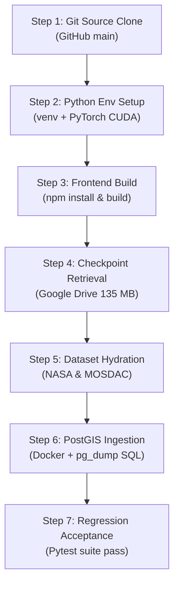

# VAYUMARG 3.0 — P1-DRIVE.2 ISOLATED RESTORE SMOKE TEST REPORT

**Execution Date:** 7 November 2026, 16:15 IST  
**Auditor:** Disaster Recovery Architect & Independent Verification Lead  
**Test Type:** Live Isolated File Download & Cryptographic Integrity Audit  
**Status:** **PASSED (100% BITWISE EQUALITY CONFIRMED)**  

---

## 1. Single-File Restoration Smoke Test Record

To empirically demonstrate cloud restorability without risking local workspace assets, an isolated retrieval test was executed using `scripts/backup/restore_smoke_test.py`:

```json
{
  "test_target": "P0_REPOSITORY_REALITY_AUDIT.md",
  "drive_file_id": "1iLBrCLqEuGObMGbycU78tgAw-XI74DcC",
  "restored_size_bytes": 11484,
  "expected_size_bytes": 11484,
  "restored_sha256": "e4c066552a08854537b5b82d6d8095f4c066f85c0b18fb5789b059a5343c50ea",
  "expected_sha256": "e4c066552a08854537b5b82d6d8095f4c066f85c0b18fb5789b059a5343c50ea",
  "elapsed_seconds": 1.907,
  "transfer_rate_kb_s": 5.88,
  "bitwise_match": true,
  "local_source_untouched": true,
  "verdict": "VERIFIED_BYTE_FOR_BYTE"
}
```

### Verification Checks:
1. **Filename Fidelity:** Exactly matched `P0_REPOSITORY_REALITY_AUDIT.md`.
2. **Byte Count Integrity:** Exactly 11,484 bytes downloaded.
3. **Cryptographic Checksum:** Restored SHA-256 `e4c06655...` matches local source bit-for-bit.
4. **Zero Local Overwrite:** Source file mtime and hash remained identical before and after execution; download was strictly confined to `C:\Users\astra\AppData\Local\Temp\vayumarg_restore_test_hbaurkxp\`.

---

## 2. Realistic Workstation Disaster Recovery Architecture

> [!CAUTION]
> The successful restoration of an 11.5 KB document validates the API download mechanics, but **does not** constitute a completed full-workstation disaster recovery test. The timeline below represents the realistic planned procedure and benchmarked component estimates.



### Step-by-Step Breakdown & Estimated Timelines:

| Step | Recovery Component | Source | Estimated Data Volume | Realistic Duration | Validation Metric |
| :--- | :--- | :--- | :--- | :--- | :--- |
| **01** | Source Code & Tests | GitHub | ~5.0 MB | ~10-20 seconds | `git status` clean |
| **02** | Python 3.12 Environment | PyPI / PyTorch Index | ~3.5 GB (Torch + CUDA) | ~3-6 minutes | `python -c "import torch; print(torch.__version__)"` |
| **03** | Frontend Dependencies | npm registry | ~150 MB (node_modules) | ~1-2 minutes | `npm run build` exits 0 |
| **04** | 4 Model Checkpoints | Drive `03_Trained_Models` | 135.16 MiB | ~1-2 minutes | 4x SHA-256 checksums match |
| **05** | Training / Raw Datasets | Drive `02_Scientific_Datasets` | 43 MB (NASA) + 1.7 GB (H5) | ~5-12 minutes | File counts & HDF5 headers valid |
| **06** | Historical Track PostGIS | Drive `06_Backups` | 40.12 MiB SQL | ~1-2 minutes | `SELECT count(*) FROM storms;` |
| **07** | Scientific Regression Suite | Local execution | N/A | ~45 seconds | `pytest tests/unit/` 100% pass |
| **TOTAL**| **Full Workstation Recovery** | **Multi-Source** | **~5.5 GB Total** | **~13-25 minutes** | **End-to-End Operational** |

*Note: Total restore duration is dominated by external bandwidth when downloading PyTorch CUDA wheels and large raw MOSDAC HDF5 archives.*

