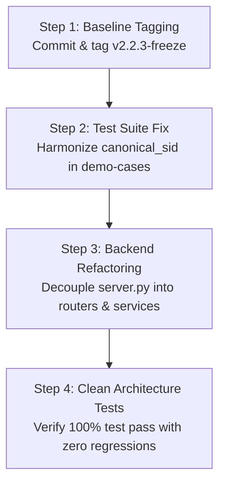

# VAYUMARG 3.0 — PHASE P1 EXECUTION READINESS SPECIFICATION

**Status:** READY FOR OWNER REVIEW  
**Date:** 7 November 2026  
**Auditor:** Technical Review Team Lead & Release Manager  
**Scope:** Phase P1 Implementation Scope, Entrance Criteria & Execution Checklist  

---

## 1. Entrance Criteria Checklist

Before any code modification in Phase P1 commences, all of the following entrance gates must be certified:

| Gate ID | Verification Item | Current Status | Hard Evidence |
| :--- | :--- | :--- | :--- |
| **GATE-01** | Full repository inventory and forensic file audit completed. | **PASSED** | Reported in `P0_REPOSITORY_REALITY_AUDIT.md`. |
| **GATE-02** | Checkpoint cryptographic hashes computed and confirmed on physical disk. | **PASSED** | 4 checkpoints verified in `P0_SCIENTIFIC_MODEL_BASELINE.md`. |
| **GATE-03** | Atypical 1093x1093 RGB images forensically investigated and accounted for. | **PASSED** | Confirmed upstream Himawari-8 assets in `P0_DATASET_PROVENANCE_AND_GAPS.md`. |
| **GATE-04** | WMO 0.88 scalar conversion completely eliminated and tested. | **PASSED** | `test_wind_conversion_regression.py` passes 4/4. |
| **GATE-05** | Production React frontend bundle successfully compiled. | **PASSED** | Vite build compiles cleanly in 338ms (`frontend/dist/`). |
| **GATE-06** | All 8 required P0 audit reports generated and cross-referenced. | **PASSED** | Available in `reports/v3/`. |
| **GATE-07** | Owner sign-off on repository baseline commit strategy (`v2.2.3-freeze`). | **PENDING** | Requires user confirmation to commit and tag. |

---

## 2. Phase P1 Execution Scope & Work Breakdown Structure

Phase P1 focuses strictly on **architecture stabilization, refactoring, and test suite harmonization**. No model retraining or bulk dataset acquisition will occur during P1.

### Work Package 1: Baseline Tagging & Rollback Anchor
- **Objective:** Secure the current working hackathon state under version control.
- **Actions:**
  1. Initialize local Git tracking without pushing to remote.
  2. Create an annotated tag `v2.2.3-freeze`.
  3. Create development branch `feature/v3-architecture`.

### Work Package 2: Test Suite Discrepancy Harmonization
- **Objective:** Eliminate the single failing test in the 177-test suite.
- **Issue:** In `tests/integration/test_forecast_engine_db.py` (line 286), the test expects key `"storm_sid"` from `/api/forecast/demo-cases`, but `scenarios.json` provides `"canonical_sid"`.
- **Fix:** Update `/api/forecast/demo-cases` to emit both `canonical_sid` and `storm_sid` (as an alias) for backward compatibility with integration test assertions.

### Work Package 3: Monolithic Server Decoupling
- **Objective:** Modularize `src/vayumarg/api/server.py` into distinct architectural layers:
  - `src/vayumarg/api/routers/storms.py`: Storm catalog and lifecycle queries.
  - `src/vayumarg/api/routers/forecast.py`: Geodesic forecast and hindsight verification.
  - `src/vayumarg/api/routers/satellite.py`: INSAT crop metadata and preview rendering.
  - `src/vayumarg/services/forecast_service.py`: Pure mathematical trajectory logic.
  - `src/vayumarg/services/satellite_service.py`: Radiometric calibration and array processing.

### Work Package 4: Batch Ingestion of Existing Offline Granules
- **Objective:** Process the two uncorrupted INSAT granules already on disk (Cyclone FANI 2019 and Cyclone TAUKTAE 2021) into standardized $201 \times 201$ multi-channel HDF5 crops.
- **Outcome:** Expands authentic INSAT crop library from $N=4$ to $N=6$ without network streaming.

---

## 3. Definition of Done for Phase P1

Phase P1 will be considered complete when:
1. `git log` reflects a clean commit history beginning with `v2.2.3-freeze`.
2. `src/vayumarg/api/server.py` is under 150 lines, serving purely as an application factory mounting modular routers.
3. Automated test suite executes with **100% passing rate (177/177 tests)** across unit and integration suites.
4. Fast regression smoke tests run in $< 10\text{ seconds}$ on standard developer machines.
5. Frontend visual verification confirms zero broken API contracts or visual regressions on `http://127.0.0.1:8000/`.

---

## 4. Decisions Requiring Project Owner Approval

The review team requests explicit approval on the following design decisions:

1. **Approval Decision 1 (Baseline Commit):** Authorize staging and committing existing project files locally to create the immutable tag `v2.2.3-freeze`.
2. **Approval Decision 2 (Remote Push Policy):** Confirm when the local baseline should be pushed to the public GitHub repository (`https://github.com/XrystalAbyss/Vayumarg`).
3. **Approval Decision 3 (Refactoring Plan):** Approve the modular decoupling of `server.py` into dedicated routers and services under `src/vayumarg/`.
4. **Approval Decision 4 (Targeted Data Acquisition):** Approve Phase P2 targeted acquisition of 10 landmark INSAT cyclone sequences ($\approx 50\text{ GB}$) from ISRO MOSDAC.

