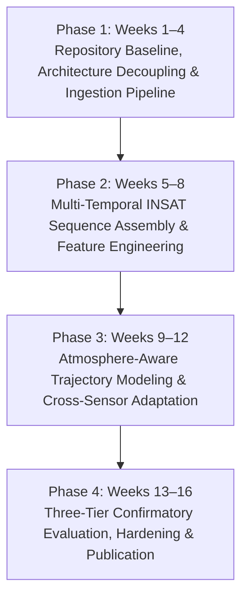

# VAYUMARG 3.0 — PRIORITIZED 16-WEEK RESEARCH ROADMAP

**Document ID:** `VAYUMARG-ROADMAP-3.0-2026-11`  
**Classification:** Research Strategy & Engineering Delivery Plan  
**Target Duration:** 16 Weeks (4 Sprints × 4 Weeks)  
**Lead Authors:** Machine Learning Research Lead & Full-Stack Architect  

---

## 1. Overview & Research Philosophy

The 16-week Vayumarg 3.0 roadmap transitions the project from a rapid hackathon prototype to an extensible, peer-reviewed scientific platform. Development is organized into four sequential 4-week phases, with explicit pre-registered hypotheses, frozen data partitions, and release milestones.

---

## 2. Phase-by-Phase Roadmap

### Phase 1: Architecture Decoupling, Baseline Tagging & Pipeline Hardening (Weeks 1–4)
- **Milestone 1.1 (Git Baseline & Tagging):** Commit all verified hackathon assets, create tag `v2.2.3-freeze`, and establish a protected `main` branch.
- **Milestone 1.2 (Backend Modularization):** Decompose monolithic `server.py` (1,151 lines) into modular routers (`routers/`), business services (`services/`), and repositories (`repositories/`).
- **Milestone 1.3 (Test Suite Standardization):** Resolve test suite discrepancies (e.g. `test_forecast_engine_db.py` expecting `storm_sid` vs `canonical_sid`) and achieve 100% passing test execution without local database dependencies.
- **Milestone 1.4 (Automated Granule Pipeline):** Enhance `src/vayumarg/satellite/crop_engine.py` to batch-process all uncorrupted MOSDAC granules on disk (incorporating FANI and TAUKTAE).

### Phase 2: Multi-Temporal INSAT Sequence Acquisition & Kinematics (Weeks 5–8)
- **Milestone 2.1 (Targeted MOSDAC Ingestion):** Ingest targeted 30-minute / 1-hour temporal sequences for 10 landmark North Indian Ocean cyclones (e.g., FANI 2019, AMPHAN 2020, TAUKTAE 2021, YAAS 2021, ASANI 2022, SITRANG 2022, MANDOUS 2022, MOCHA 2023, BIPARJOY 2023, REMAL 2024). Estimated storage: $\approx 50\text{ GB}$.
- **Milestone 2.2 (Multi-Channel Coregistration Engine):** Resample all 4 channels (TIR-1, TIR-2, WV, MIR) into consistent spatiotemporal tensors ($T=4, C=4, H=201, W=201$).
- **Milestone 2.3 (Dataset Manifest v3):** Build a cryptographically signed sequence manifest with precise observation timestamps, eliminating hardcoded dimension assumptions.
- **Milestone 2.4 (Sequence Kinematics Evaluation):** Evaluate Spatiotemporal ConvLSTM on genuine aligned INSAT sequences, benchmarking against high-resolution persistence.

### Phase 3: Atmosphere-Aware Trajectory Modeling & Environmental Features (Weeks 9–12)
- **Milestone 3.1 (Environmental Reanalysis Feature Ingestion):** Ingest coarse-resolution ($0.25^\circ$) steering flow fields from Copernicus ERA5 / GFS analyses for historical cyclones:
  - 850 hPa zonal ($u$) and meridional ($v$) winds (low-level steering).
  - 200 hPa winds and 850–200 hPa deep vertical wind shear magnitude ($U_{\text{shear}}$).
  - 500 hPa geopotential height ($Z_{500}$) contours (subtropical ridge positioning).
  - Sea Surface Temperature (SST) and Ocean Heat Content (OHC) proxies.
- **Milestone 3.2 (Physics-Guided Residual Model):** Re-train the hybrid residual track model using environmental steering vectors as auxiliary inputs rather than coordinate history alone.
- **Milestone 3.3 (Cross-Sensor Adaptation):** Implement domain-adaptation techniques (CORAL, MMD, or fine-tuning of intermediate ResNet layers) to bridge the $10.3\text{ µm} \to 10.8\text{ µm}$ spectral response gap.

### Phase 4: Confirmatory Evaluation, UI Integration & Final Release (Weeks 13–16)
- **Milestone 4.1 (Three-Tier Confirmatory Testing):** Unlock the cryptographically sequestered Tier 3 test partition (2021–2024 storms) and execute final evaluation runs.
- **Milestone 4.2 (Calibrated Uncertainty Cones):** Integrate parametric bivariate Gaussian and non-parametric empirical quantile cones of uncertainty into the interactive frontend basemap.
- **Milestone 4.3 (Frontend Polish & Packaging):** Update the React UI to display multi-horizon environmental overlays, model comparison matrices, and reproducibility receipts.
- **Milestone 4.4 (Vayumarg 3.0 Open-Source Release):** Publish clean-clone documentation, containerized Docker deployment scripts, and release report.

---

## 3. Pre-Registered Hypotheses & Experiment Matrix

| Hypothesis ID | Scientific Domain | Null Hypothesis ($H_0$) | Alternative Hypothesis ($H_1$) | Validation Metric | Decision Gate |
| :--- | :--- | :--- | :--- | :--- | :--- |
| **HYP-01** | Trajectory Forecasting | Incorporating ERA5 850 hPa steering winds does not improve +24h track error over geodesic baseline. | Steering-conditioned hybrid model reduces +24h track error by $\ge 15\%$ relative to geodesic baseline. | Mean Great-Circle Error at +24h ($\text{km}$). | If $p > 0.05$ on confirmatory cohort, retain geodesic baseline as exclusive primary engine. |
| **HYP-02** | Satellite Vision Fusion | Multi-channel fusion (TIR-1 + WV + MIR) achieves intensity MAE equal to or worse than single-channel TIR-1. | Multi-channel fusion resolves upper-tropospheric outflow and dry air intrusion, improving MAE by $\ge 1.5\text{ kt}$. | Intensity MAE ($\text{knots}$) on sequestered test cyclones. | If MAE does not improve, maintain lightweight single-channel inference pipeline. |
| **HYP-03** | Temporal Kinematics | ConvLSTM next-frame reconstruction skill on 30-min INSAT sequences does not exceed persistence baseline. | ConvLSTM captures rotational eyewall kinematics, achieving $\ge 25\%$ pixel MSE reduction vs persistence. | Next-Frame Pixel Mean Squared Error (MSE). | If skill $< 10\%$, deprecate ConvLSTM in favor of optical flow. |

---

## 4. Compute, Storage & Infrastructure Requirements

- **Local Storage:**
  - Raw Level-1B Granules (10 storms × 20 frames): $\approx 60\text{ GB}$.
  - Calibrated Coregistered Crops (HDF5): $\approx 2.5\text{ GB}$.
  - ERA5 Steering Cutouts ($0.25^\circ$ NIO bounding box): $\approx 1.2\text{ GB}$.
  - Total Disk Footprint: $< 75\text{ GB}$ (feasible on standard 512 GB / 1 TB NVMe SSD).
- **Compute Hardware:**
  - Training & Evaluation: NVIDIA GeForce RTX 4050 Laptop GPU (6 GB VRAM) is completely sufficient for ResNet-18, ConvLSTM ($64 \times 64$), and Track GRU training.
  - Production Inference: CPU-only execution feasible ($\le 120\text{ ms}$ per sample with ONNX Runtime or TorchScript).
- **Network Bandwidth:** Modest streaming access to ISRO MOSDAC and Copernicus Climate Data Store (CDS). No massive multi-terabyte bulk downloads required.

